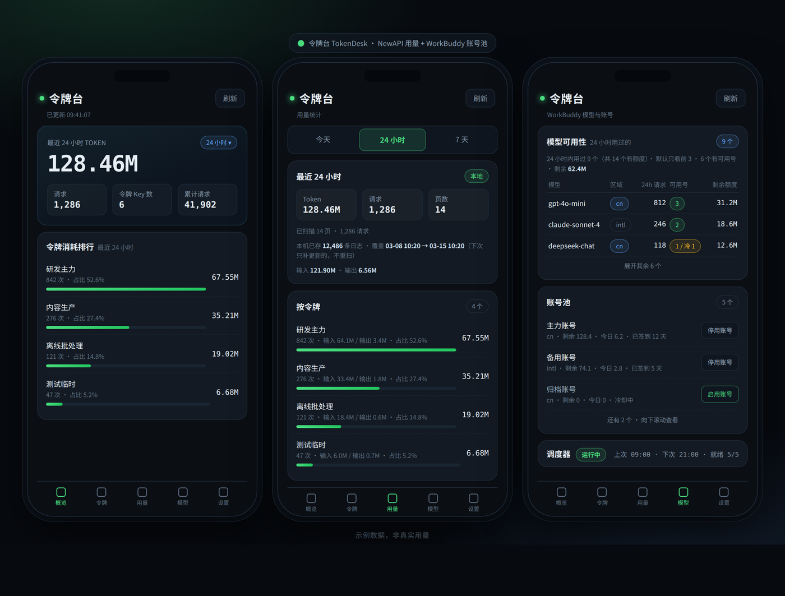

# 令牌台 TokenDesk

手机上的 LLM 网关遥控器：查看 NewAPI 的令牌用量，管理令牌与账号池。



*示例数据，非真实用量*

## 功能

| 页签 | 内容 |
|---|---|
| 概览 | 今日 / 24 小时 token 与请求数、令牌消耗排行 |
| 令牌 | 按消耗排序、启用停用、改额度与模型白名单、复制 Key、删除 |
| 用量 | 按令牌 / 按模型拆分，今天 / 24 小时 / 7 天切换，本地缓存、切换不发请求 |
| 模型 | 账号池状态与逐个启停、模型可用性与额度 |
| 设置 | 地址与凭证、请求通道、自动刷新 |

只接 NewAPI 或只接账号池面板都能用。

## 相关项目

本项目只是手机客户端，本身不含网关能力，需要配合下面这些开源项目使用：

| 项目 | 作用 | 地址 |
|---|---|---|
| **NewAPI** | LLM 网关：令牌、额度、调用日志（App 的「概览 / 令牌 / 用量」页） | https://github.com/QuantumNous/new-api |
| **WorkBuddy2API Hub** | 多账号反代网关 + 面板接口：账号池、模型用量、调度器（App 的「模型」页） | https://github.com/ardeyouxipianyi/workbuddy2api-hub |

TokenDesk 与上述项目**没有隶属关系**，也不修改它们，只是调用其公开的 HTTP 接口。接口变动导致不兼容时，以对应项目的文档为准。

## 安装

Android 7.0+，从 Releases 下载 APK 安装。

## 首次配置

打开 App → 设置：

1. 网关地址，例如 `http://192.0.2.10:3000`
2. 管理令牌（NewAPI 里「个人设置 → 安全设置 → 系统访问令牌」，不是 `sk-` 开头的密钥）
3. 用户 ID（Root 用户填 `1`）

点「保存并连接」。账号池面板可选：填面板地址与密码。

## 构建

```bash
./build.sh
```

需要 Android SDK（build-tools 34.0.0、platforms/android-34）、JDK 17+、python3、zip。
产物在 `dist/`，签名与配置在 `.signing/`、`.env`，均已在 `.gitignore`。

## 许可

MIT
